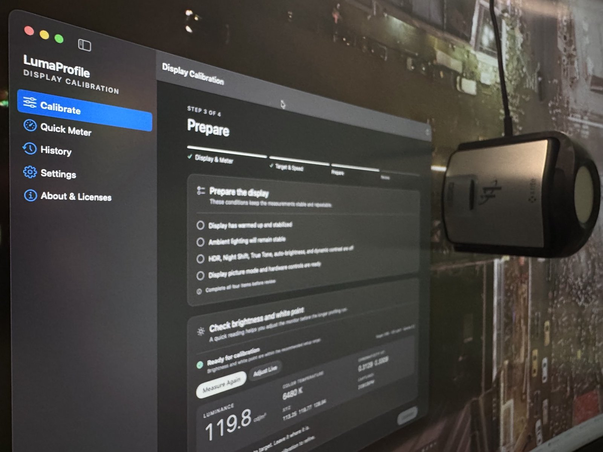
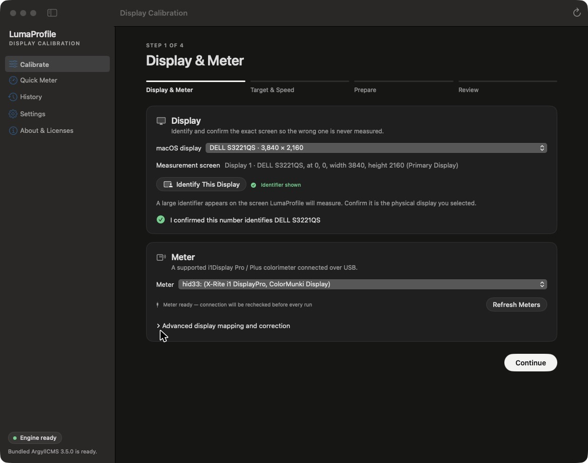
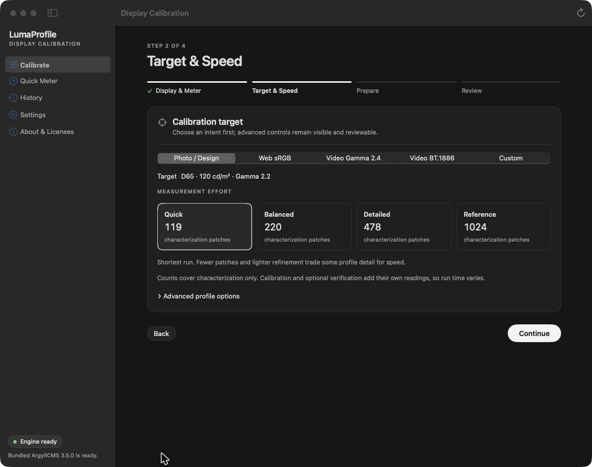
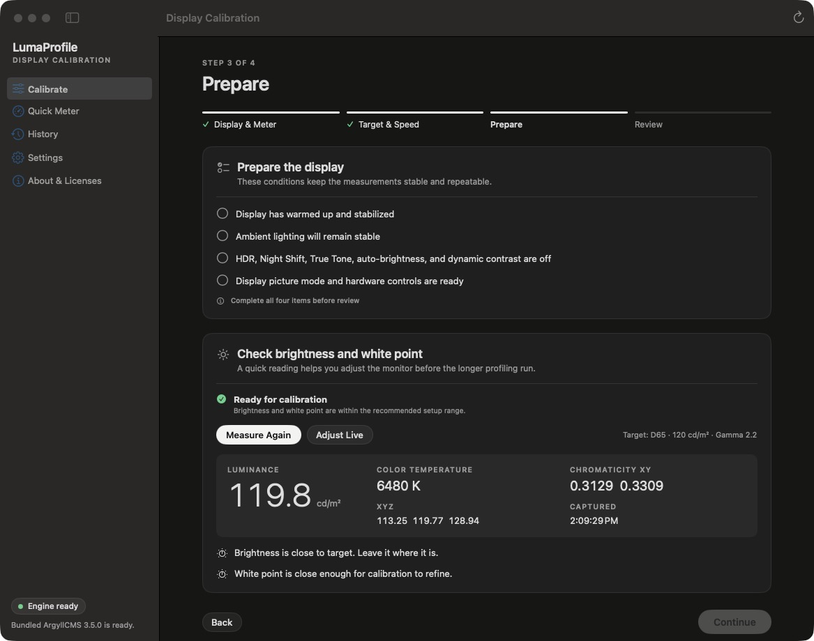
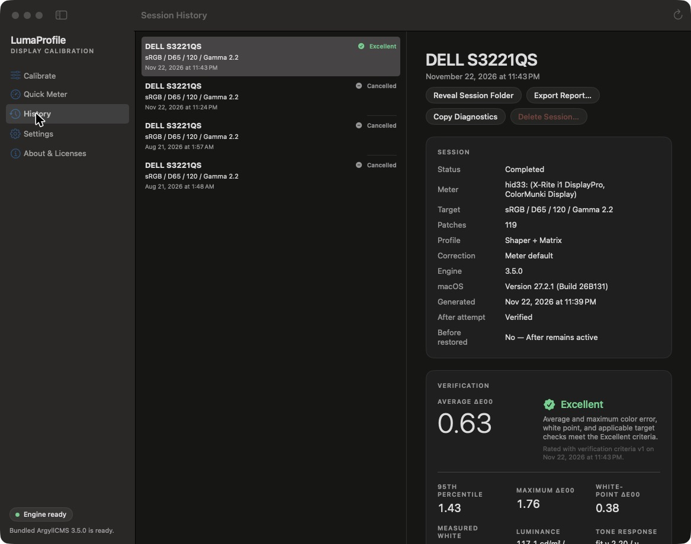

<div align="center">

# LumaProfile

**Make your Mac screen show true colors.**<br>
Plug in a color meter. Click through 4 steps. Get a checked color profile.



</div>

## What it does

- **Guides you.** 4 short steps. It won't start until you pick the right screen.
- **Shows the change.** Flip Before / After and see it yourself.
- **Helps you set brightness.** *Adjust Live* tells you "lower it" or "raise it".
- **Checks its own work.** It measures the result and gives a grade.
- **Keeps you safe.** Your old profile is saved first. Cancel and it comes back.
- **One install.** The color engine (ArgyllCMS) is inside the app.
- **Private.** Nothing leaves your Mac.

## See it

<table>
  <tr>
    <td width="50%"></td>
    <td width="50%"></td>
  </tr>
  <tr>
    <td align="center"><b>1. Pick screen + meter</b></td>
    <td align="center"><b>2. Pick target + speed</b></td>
  </tr>
  <tr>
    <td width="50%"></td>
    <td width="50%"></td>
  </tr>
  <tr>
    <td align="center"><b>3. Check brightness</b></td>
    <td align="center"><b>4. See your grade</b></td>
  </tr>
</table>

## Real result

One test on the maker's own screen (Dell S3221QS + i1 Display Pro):

| Color error (avg) | Worst error | White point | Brightness | Gamma |
|:-:|:-:|:-:|:-:|:-:|
| **0.63** | 1.76 | 0.38 | 117 cd/m² | 2.20 |

Lower error is better. LumaProfile graded it **Excellent**. This is one run on one setup. Your results may differ.

## Try it

You need:
- An Apple Silicon Mac on macOS 15 or newer
- An X-Rite i1Display Pro or Plus meter (USB)

There is no download yet. Build it yourself:

```sh
Scripts/fetch-argyllcms.sh
swift build -c release --product LumaProfileApp
Scripts/package-dmg.sh
```

Open the `.dmg` in `outputs/`. Drag LumaProfile to Applications.

## Good to know

- **Not notarized.** macOS may ask you to approve it once. Right-click the app and choose **Open**.
- **Tested on one setup only.** Other screens and meters are untested.
- **No admin password.** Never run it with `sudo`.

## More

- [Full guide](docs/guide.md): steps, safety, rollback, limits
- [Hardware test checklist](docs/manual-hardware-acceptance.md)
- [Contributing](CONTRIBUTING.md) · [Security](SECURITY.md) · [Project notes](PROJECT_STATE.md)

Licensed under AGPLv3. Includes ArgyllCMS 3.5.0 (AGPLv3). See [third-party notices](THIRD_PARTY_NOTICES.md).
